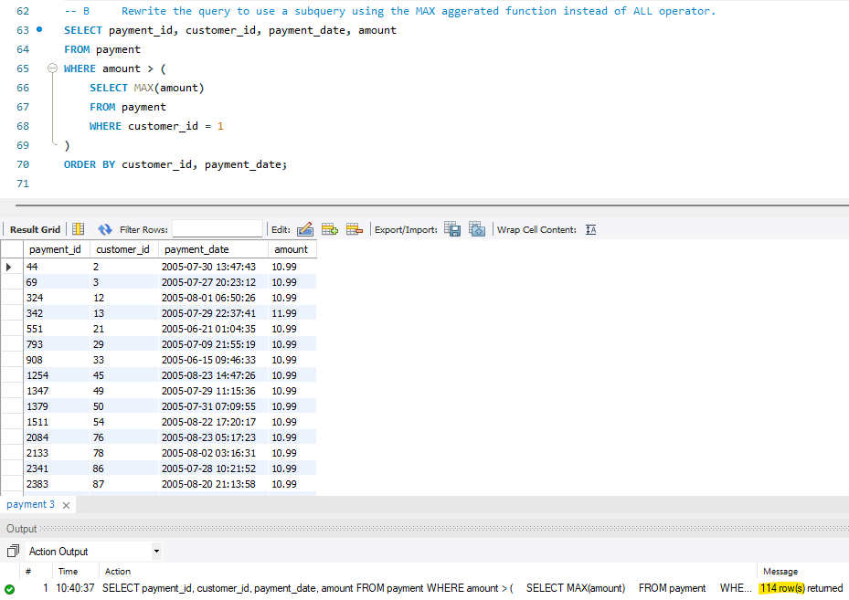
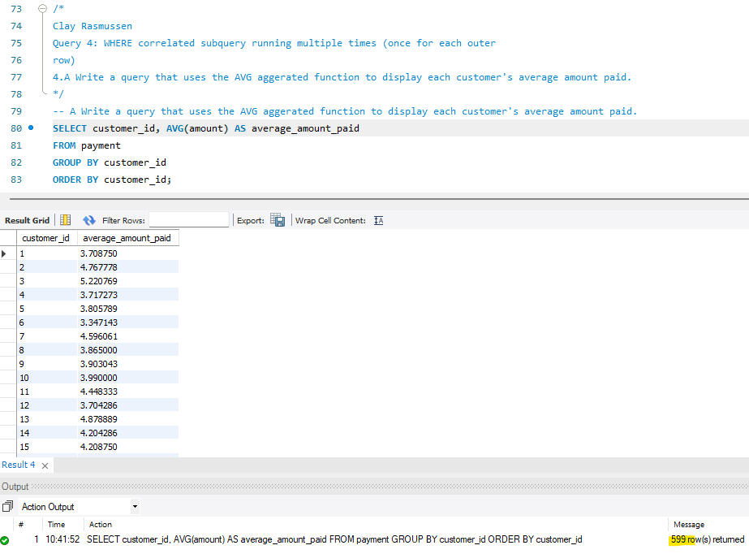
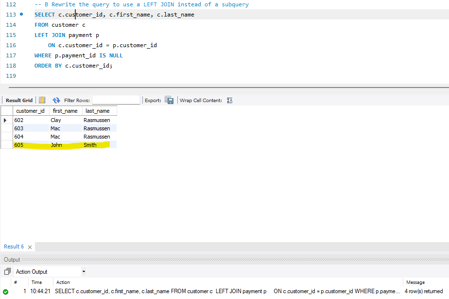
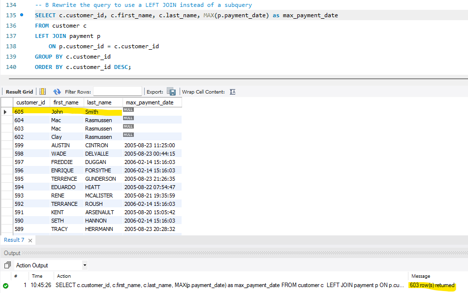
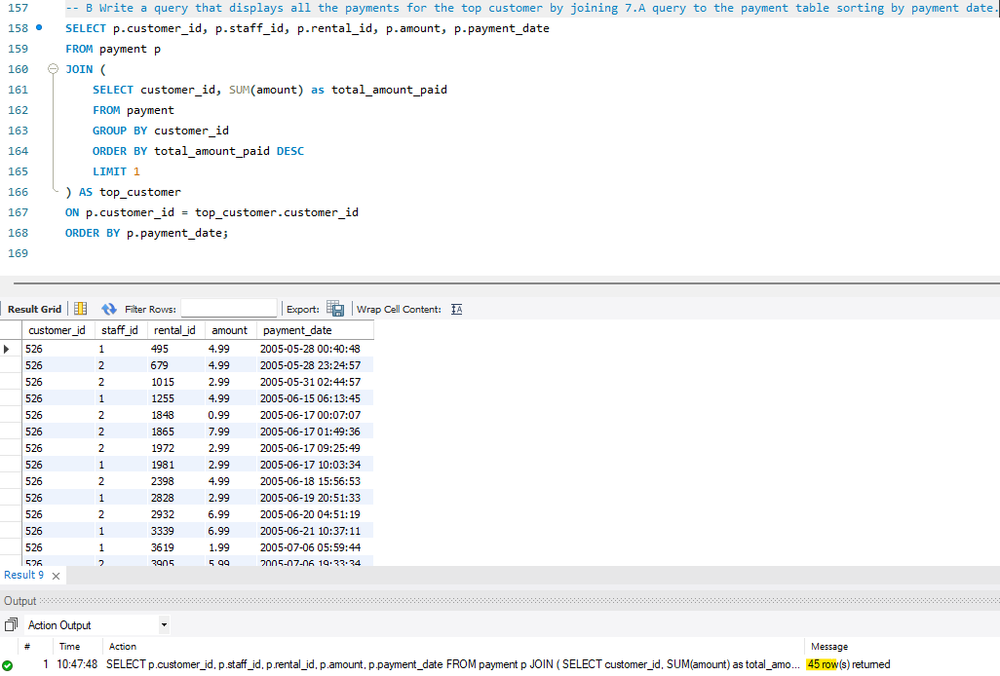

# Chapter 7 - Subqueries

## Table of Contents

  - [Tech Stack](#tech-stack)
  - [Installation](#installation)
  - [Query 1 - WHERE subquery returning one value](#query-1---WHERE-subquery-returning-one-value)
  - [Query 2 - WHERE subquery returning a list](#query-2---WHERE-subquery-returning-a-list)
  - [Query 3 - WHERE ALL keyword subquery returning a list](#query-3---WHERE-ALL-keyword-subquery-returning-a-list)
  - [Query 4 - WHERE correlated subquery running multiple times](#query-4---WHERE-correlated-subquery-running-multiple-times)
  - [Query 5 - WHERE EXISTS operator subquery returning a boolean value](#query-5---WHERE-EXISTS-operator-subquery-returning-a-boolean-value)
  - [Query 6 - SELECT subquery returning a single value](#query-6---SELECT-subquery-returning-a-single-value)
  - [Query 7 - FROM subquery returning an inline view](#query-7---FROM-subquery-returning-an-inline-view)
  - [Help](#help)
  - [Authors](#authors)

## Tech Stack

**Sakila Database**

[Back to the top](#table-of-contents)

## Installation

1. Clone the repository to your local machine. (Or just steal my code.)
2. Install MySQL if it is not already installed.
3. Download and install the Sakila sample database.
4. Open the project in VS Code or your preferred SQL editor.
5. Select the Sakila database before running the queries.
6. Run each query individually to verify the results.

[Back to the top](#table-of-contents)

## Query 1 - WHERE subquery returning one value

### What This Exercise Was About
add

### New Concepts
- add

### Learning Outcomes
- add

**Screenshot of Output:**

[Back to the top](#table-of-contents)

---

## Query 2 - WHERE subquery returning a list

### What This Exercise Was About

add
### New Concepts

- add

### Learning Outcomes

- add

**Screenshot of Output:**

[Back to the top](#table-of-contents)

---

## Query 3 - WHERE ALL keyword subquery returning a list

### What This Exercise Was About
add

### New Concepts
- add

### Learning Outcomes
- add

**Screenshot of Output:**

[Back to the top](#table-of-contents)

---

## Query 4 - WHERE correlated subquery running multiple times

### What This Exercise Was About
add

### New Concepts
- add

### Learning Outcomes
- add

**Screenshot of Output:**

Chapter 7 Query 4A

Chapter 7 Query 4B

[Back to the top](#table-of-contents)

---

## Query 5 - WHERE EXISTS operator subquery returning a boolean value

### What This Exercise Was About
add

### New Concepts
- add

### Learning Outcomes
- add

**Screenshot of Output:**

Chapter 7 Query 5B

[Back to the top](#table-of-contents)

---

## Query 6 - SELECT subquery returning a single value

### What This Exercise Was About
add

### New Concepts
- add

### Learning Outcomes
- add

**Screenshot of Output:**

[Back to the top](#table-of-contents)

---

## Query 7 - FROM subquery returning an inline view

### What This Exercise Was About
add

### New Concepts
- add

### Learning Outcomes
- add

**Screenshot of Output:**

Chapter 7 Query 7A

Chapter 7 Query 7B

[Back to the top](#table-of-contents)

---

## Help
___
If you encounter issues while completing the exercises, try the following troubleshooting steps:

- Make sure the MySQL server is running correctly.
- Confirm that the Sakila database is selected before executing queries.
- Verify that each SQL statement is written correctly and follows the required column order.
- Execute statements individually to identify where an error occurs.
- Check that records referenced by foreign keys exist before inserting related records.
- Review foreign key constraints if a deletion fails.
- Verify that the correct IDs are being used in `UPDATE` and `DELETE` statements.
- Refresh the schema window after creating or dropping tables.
- Restart your SQL editor if it stops responding.
- If necessary, re-clone the repository and confirm that all required files are present.

[Back to the top](#table-of-contents)

## Authors
___

**Clay Rasmussen**
* **Clay's GitHub Profile**: [Clay-Rasmussen](https://github.com/Clay-Rasmussen)
* **Clay's Email**: [clrasm02@wsc.edu](mailto:clrasm02@wsc.edu)

[Back to the top](#table-of-contents)
