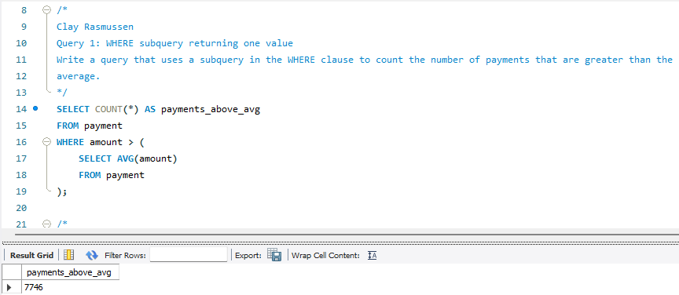
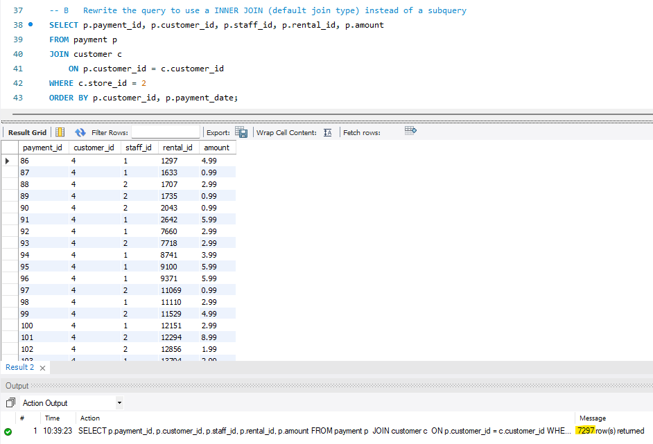
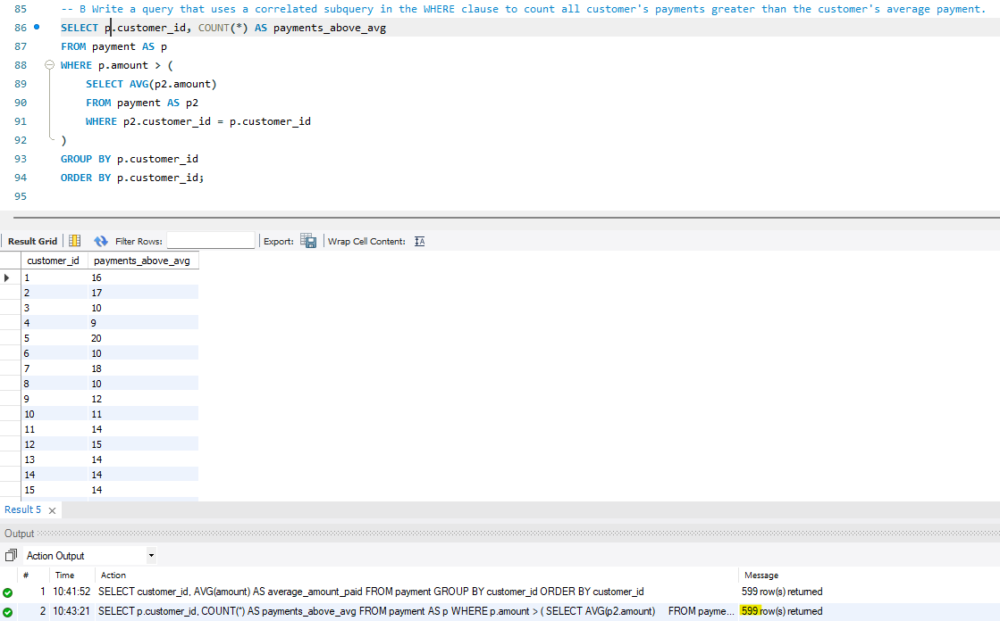
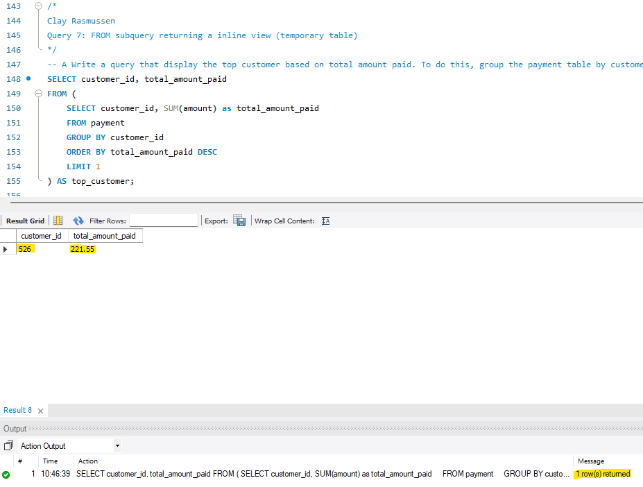

# Chapter 7 - Subqueries

## Table of Contents

  - [Tech Stack](#tech-stack)
  - [Installation](#installation)
  - [Query 1 - WHERE subquery returning one value](#query-1---WHERE-subquery-returning-one-value)
  - [Query 2 - WHERE subquery returning a list](#query-2---WHERE-subquery-returning-a-list)
  - [Query 3 - WHERE ALL keyword subquery returning a list](#query-3---WHERE-ALL-keyword-subquery-returning-a-list)
  - [Query 4 - WHERE correlated subquery running multiple times](#query-4---WHERE-correlated-subquery-running-multiple-times)
  - [Query 5 - WHERE EXISTS operator subquery returning a boolean value](#query-5---WHERE-EXISTS-operator-subquery-returning-a-boolean-value)
  - [Query 6 - SELECT subquery returning a single value](#query-6---SELECT-subquery-returning-a-single-value)
  - [Query 7 - FROM subquery returning an inline view](#query-7---FROM-subquery-returning-an-inline-view)
  - [Help](#help)
  - [Authors](#authors)

## Tech Stack

**Sakila Database**

[Back to the top](#table-of-contents)

## Installation

1. Clone the repository to your local machine. (Or just steal my code.)
2. Install MySQL if it is not already installed.
3. Download and install the Sakila sample database.
4. Open the project in VS Code or your preferred SQL editor.
5. Select the Sakila database before running the queries.
6. Run each query individually to verify the results.

[Back to the top](#table-of-contents)

## Query 1 - WHERE subquery returning one value

### What This Exercise Was About
This exercise uses a scalar subquery in the WHERE clause to find payments whose amount is greater than the average payment amount. The
outer query counts the matching payments.

### New Concepts
- Scalar subqueries that return one value
- Aggregate functions such as `AVG()` and `COUNT()`
- Comparing a value with a subquery result in a WHERE clause

### Learning Outcomes
- Use a subquery to calculate an aggregate value for comparison.
- Count rows that meet a condition based on the overall average payment.

**Screenshot of Output:**

[Back to the top](#table-of-contents)

---

## Query 2 - WHERE subquery returning a list

### What This Exercise Was About
This exercise finds payments made by customers associated with store 2. Query 2.A uses an `IN` subquery to return the relevant customer IDs, and Query 2.B rewrites the same task with an `INNER JOIN`. Both versions sort the results by customer ID and payment date.

### New Concepts
- Subqueries that return a list of values
- The `IN` operator
- Rewriting a subquery as an `INNER JOIN`
- Sorting results with `ORDER BY`

### Learning Outcomes
- Filter payment rows using a list of customer IDs from another query.
- Express the same relationship with either an `IN` subquery or an `INNER JOIN`.

**Screenshot of Output:**

[Back to the top](#table-of-contents)

---

## Query 3 - WHERE ALL keyword subquery returning a list

### What This Exercise Was About
This exercise displays payments whose amount is greater than every payment made by customer 1. Query 3.A compares payment amounts with the
list returned by a subquery using `> ALL`; Query 3.B performs the same comparison using the maximum payment amount from customer 1. Results
are ordered by customer ID and payment date.

### New Concepts
- The `ALL` comparison operator with a subquery
Comparing a value against every value in a returned list
The `MAX()` aggregate function as an alternative to `> ALL`

### Learning Outcomes
- Find values greater than all values in a subquery result.
- Recognize when an aggregate such as `MAX()` can express the same threshold.

**Screenshot of Output:**

[Back to the top](#table-of-contents)

---

## Query 4 - WHERE correlated subquery running multiple times

### What This Exercise Was About
Query 4.A calculates each customer's average payment. Query 4.B uses a correlated subquery to count, for each customer, the payments
greater than that customer's own average. The inner query refers to the current customer from the outer query.

### New Concepts
- Correlated subqueries
- Subqueries that run in relation to rows from the outer query
- Per-customer aggregation with `AVG()` and `COUNT()`

### Learning Outcomes
- Calculate an aggregate separately for each customer.
- Use an outer-query value inside a subquery to make a row-specific comparison.
- Count each customer's payments that exceed that customer's average.

**Screenshot of Output:**

Chapter 7 Query 4A

Chapter 7 Query 4B

[Back to the top](#table-of-contents)

---

## Query 5 - WHERE EXISTS operator subquery returning a boolean value

### What This Exercise Was About
This exercise identifies customers who have no payment records. The assignment first requires a new customer with no payments. Query 5.A
checks for the absence of matching payment rows with `NOT EXISTS`, and Query 5.B rewrites the result using a `LEFT JOIN` and a null check.

### New Concepts
- `EXISTS` and `NOT EXISTS`
- Boolean existence checks in a `WHERE` clause
- Finding unmatched records with a `LEFT JOIN`
- Checking for `NULL` values

### Learning Outcomes
- Find customers without related payment records.
- Use `NOT EXISTS` to test that a related row is absent.
- Rewrite an anti-match query with a `LEFT JOIN` and `NULL` check.

**Screenshot of Output:**

Chapter 7 Query 5B

[Back to the top](#table-of-contents)

---

## Query 6 - SELECT subquery returning a single value

### What This Exercise Was About
Query 6.A uses a correlated subquery in the `SELECT` clause to display each customer's most recent payment date, ordering customers by ID in
descending order. Query 6.B rewrites the result using a `LEFT JOIN`.

### New Concepts
- Scalar subqueries in the `SELECT` clause
- Correlated subqueries
- The `MAX()` aggregate function
- Rewriting a scalar subquery with a `LEFT JOIN`

### Learning Outcomes
- Add a calculated value to each output row with a subquery in the `SELECT` clause.
- Find each customer's latest payment date.
- Preserve customers with no matching payment when using a `LEFT JOIN.`

**Screenshot of Output:**

[Back to the top](#table-of-contents)

---

## Query 7 - FROM subquery returning an inline view

### What This Exercise Was About
Query 7.A groups payments by customer, sorts customers by total amount paid, and limits the result to the top customer. Query 7.B uses that
result as an inline view, joins it to the payment table, and displays the top customer's payments in payment-date order.

### New Concepts
- Subqueries in the `FROM` clause
- Inline views (derived tables)
- Grouping and aggregation with `GROUP BY` and `SUM()`
- Sorting and limiting results with `ORDER BY` and `LIMIT`
- Joining an inline view to a table

### Learning Outcomes
- Build a temporary result set in the `FROM` clause and query it like a table.
- Identify the customer with the greatest total payment amount.
- Use an inline view to retrieve all payment rows for that customer.

**Screenshot of Output:**

Chapter 7 Query 7A

Chapter 7 Query 7B

[Back to the top](#table-of-contents)

---

## Help
___
If you encounter issues while completing the exercises, try the following troubleshooting steps:

- Make sure the MySQL server is running correctly.
- Confirm that the Sakila database is selected before executing queries.
- Verify that each SQL statement is written correctly and follows the required column order.
- Execute statements individually to identify where an error occurs.
- Check that records referenced by foreign keys exist before inserting related records.
- Review foreign key constraints if a deletion fails.
- Verify that the correct IDs are being used in `UPDATE` and `DELETE` statements.
- Refresh the schema window after creating or dropping tables.
- Restart your SQL editor if it stops responding.
- If necessary, re-clone the repository and confirm that all required files are present.

[Back to the top](#table-of-contents)

## Authors
___

**Clay Rasmussen**
* **Clay's GitHub Profile**: [Clay-Rasmussen](https://github.com/Clay-Rasmussen)
* **Clay's Email**: [clrasm02@wsc.edu](mailto:clrasm02@wsc.edu)

[Back to the top](#table-of-contents)
